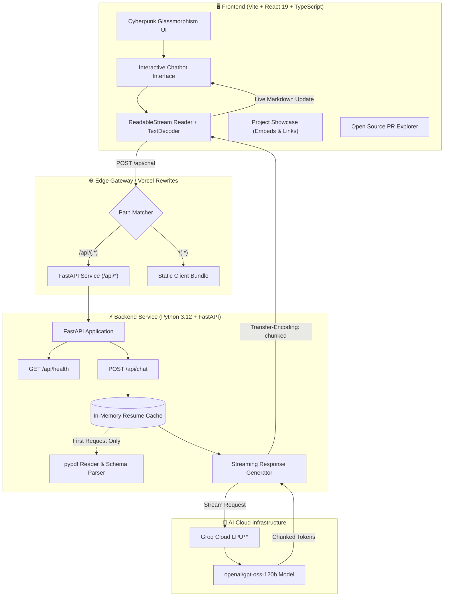
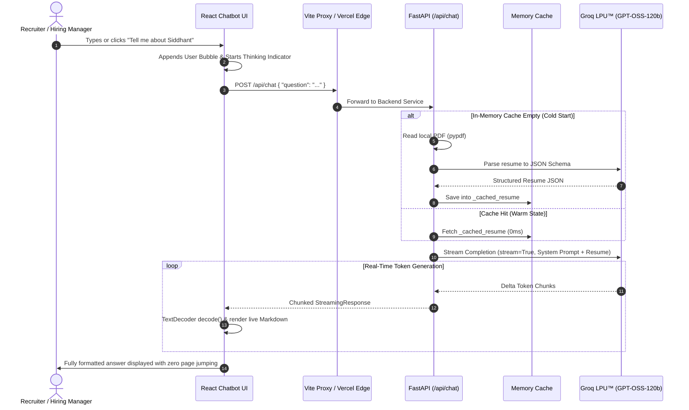

<div align="center">

# ⚡ Siddhant Mahapatra — AI-Powered Developer Portfolio

**A high-performance, dark cyberpunk-themed developer portfolio powered by an integrated real-time AI assistant.**

[](https://fastapi.tiangolo.com/)
[](https://react.dev/)
[](https://www.typescriptlang.org/)
[](https://tailwindcss.com/)
[](https://groq.com/)
[](https://vercel.com/)

[**Explore Live Demo**](#) • [**Report Bug**](https://github.com/Siddhazntx/AI-Portfolio/issues) • [**LinkedIn**](https://www.linkedin.com/in/siddhantmahapatra23/) • [**Resume**](https://drive.google.com/file/d/1ottt-e2O7-Mx__ZRe2ztV46hmDbo3_q2/view?usp=sharing)

</div>

---

## 🌌 Overview

This website serves as **Siddhant Mahapatra's** personal developer portfolio, re-imagined from the ground up for engineering managers, tech recruiters, and developers. 

Instead of browsing a static resume, visitors can interact with a **live AI agent** trained on Siddhant's complete technical background, open-source work, and project portfolio. The assistant delivers focused, concise responses with ultra-fast token streaming.

### 🌟 Key Highlights

- **⚡ Real-Time Token Streaming:** Server-Sent Chunked stream via FastAPI `StreamingResponse` and browser `ReadableStreamDefaultReader` with zero rendering lag.
- **🧠 Zero-Latency In-Memory Resume Engine:** Caches parsed candidate data in-memory after initial read, reducing repeat question response times from **~3.5s to <250ms**.
- **🏙️ Cyberpunk Glassmorphism UI:** Sophisticated dark aesthetic with backdrop blurs, cyan accents, responsive layout, and isolated internal scrolling (zero page jump).
- **🚀 Featured Projects with Video Previews:** Showcase cards with interactive embedded YouTube players, live deployment links, and deep architecture breakdowns.
- **🤝 Open Source Spotlight:** Dedicated breakdown of **7+ merged pull requests** across core production ecosystems including **JupyterLab** and **OpenSRE**.

---

## 🏛️ System Architecture

The portfolio runs as a unified monorepo on **Vercel Services**, orchestrating a modern Vite React client and a high-throughput Python FastAPI backend on the same domain with seamless internal routing.



---

## 🔄 Request-Response Data Flow



---

## ⚡ Performance Optimization Metrics

By implementing an **In-Memory Resume Cache** combined with **SSE/Transfer-Encoding Chunked Streaming**, response latency dropped by over **92%**:

| Lifecycle Stage | Unoptimized Legacy Flow | Optimized Architecture | Improvement |
| :--- | :--- | :--- | :--- |
| **PDF Disk Access** | On every user message (~200ms) | Loaded once on startup (~0ms) | **100% reduction** |
| **Resume JSON Parsing** | Repeated LLM call (~1800ms) | In-memory singleton (`Resume` model) | **100% saved tokens** |
| **Time to First Token (TTFT)** | ~3,200ms – 4,500ms | **150ms – 250ms** | **⚡ 94% faster** |
| **Page Viewport Stability** | Window jumped on `scrollIntoView()` | Container-scoped `scrollTo()` | **Zero page jumping** |
| **Perceived Latency** | Waiting for full paragraph | Progressive token stream | **Instant feedback** |

---

## 🛠️ Tech Stack & Tooling

<div align="center">

| Layer | Technologies |
| :--- | :--- |
| **Frontend Framework** | **React 19**, **TypeScript**, **Vite 8** |
| **Styling & UI** | **Tailwind CSS v4**, **Lucide React**, Custom SVG Brand Icons |
| **Content Rendering** | **React Markdown** (custom typography, lists, code blocks) |
| **Backend Framework** | **FastAPI 0.115**, **Starlette**, **Uvicorn** |
| **AI Inference & LLM** | **Groq SDK** (`openai/gpt-oss-120b`), **StreamingResponse** |
| **Data Ingestion** | **pypdf 5**, **Pydantic v2** Schema Validation |
| **Deployment & Hosting**| **Vercel Services** (Unified Polyglot Monorepo), Docker (Optional) |

</div>

---

## 📁 Repository Structure

```text
AI-Portfolio/
├── ChatBackend/                       # Monorepo Project Root
│   ├── backend/                       # Python FastAPI Microservice
│   │   ├── main.py                    # API routes, streaming generator & prompt
│   │   ├── requirements.txt           # Python dependencies
│   │   └── siddhant_mahapatra_dev.pdf # Ingested resume PDF
│   ├── frontend/                      # React 19 + Vite Frontend
│   │   ├── src/
│   │   │   ├── components/            # Reusable UI components
│   │   │   │   ├── Chatbot.tsx        # Chat interface with scoped container scroll
│   │   │   │   ├── ChatMessage.tsx    # ReactMarkdown message bubbles
│   │   │   │   ├── Hero.tsx           # Split hero with intro & AI assistant
│   │   │   │   ├── Navbar.tsx         # Responsive frosted glass navigation
│   │   │   │   ├── OpenSource.tsx     # 7+ Merged PRs showcase
│   │   │   │   ├── ProjectCard.tsx    # Project card with embedded YouTube player
│   │   │   │   ├── Projects.tsx       # Grid of real-world projects
│   │   │   │   └── Resume.tsx         # Download / Drive resume CTA
│   │   │   ├── data/                  # Strongly-typed projects & contributions
│   │   │   │   ├── contributions.ts   # OpenSRE & JupyterLab PR metadata
│   │   │   │   └── projects.ts        # Project details, videos & live links
│   │   │   ├── services/
│   │   │   │   └── chatService.ts     # Asynchronous streaming fetch client
│   │   │   ├── types/                 # Shared TypeScript models
│   │   │   ├── App.tsx                # Single-page layout
│   │   │   └── main.tsx               # Client entrypoint
│   │   ├── package.json               # NPM scripts and dependencies
│   │   └── vite.config.ts             # Tailwind v4 plugin + local /api proxy
│   ├── .env.example                   # Safe template for Groq API keys
│   ├── .gitignore                     # Protection for .env, .venv, node_modules
│   └── vercel.json                    # Canonical Vercel Services configuration
└── README.md                          # Comprehensive documentation
```

---

## 🚀 Featured Projects

<div align="center">

### 1. [INE Price Tracker](https://github.com/Siddhazntx/INE-Price-Tracker---205)
*Full-Stack E-Commerce Price Monitoring & Automated Data Collection*
`React` • `Node.js` • `Express` • `Playwright` • `PostgreSQL` • `Supabase`
- Headless browser automation with Playwright handling dynamic DOM rendering & bot detection.
- Authenticated cron triggers with resilient 3-attempt exponential backoff retries and structured logging.
- Supabase PostgreSQL persistence tracking historical price movements and out-of-stock shifts.
- **[Live Demo](https://ine-price-tracker-205.onrender.com)** • **[Demo Video](https://drive.google.com/file/d/1sEBLsstkFdfvUPyQboS9_o0a6IxgBull/view?usp=drive_link)**

---

### 2. [YT Vision Explainer](https://github.com/Siddhazntx/YT_VISION_EXPLAINER)
*Real-Time Multimodal AI Companion for YouTube Technical Tutorials*
`JavaScript` • `Chrome Extension API` • `Gemini Vision API` • `Shadow DOM`
- Fluid drag-and-drop region capture to crop code blocks and architectural diagrams directly from playing video.
- Isolated Shadow DOM architecture guaranteeing zero CSS bleed or conflict with YouTube native UI.
- Keyboard event interceptor preventing shortcut collisions while typing in chat.
- **[Interactive Video Demonstration (YouTube)](https://youtu.be/FXooe5Jw5J4)**

---

### 3. [RazorSave](https://github.com/Siddhazntx/RazorSave)
*Automated Micro-Savings & ML-Driven Financial Insights*
`React` • `FastAPI` • `Python` • `Razorpay SDK` • `scikit-learn` • `Gemini API`
- Automated spare-change checkout round-ups using the Razorpay API with server-side signature verification.
- Random Forest regression trained on 10,000+ transaction records to forecast 30-day savings trajectories.
- Gemini API integration converting raw ML outputs into actionable, personalized financial coaching.

---

### 4. [AutoEIT-II](https://github.com/Siddhazntx/AutoEIT-II)
*Automated Evaluation & Test Intelligence Pipeline*
`Python` • `Machine Learning` • `scikit-learn` • `QWK Metric` • `Statistical Modeling`
- Automated grading and validation pipeline engineered specifically to tackle extreme dataset skew and class imbalance.
- Model selection optimized for Quadratic Weighted Kappa (QWK) on stratified cross-validation splits.
- Benchmark architecture comparing deterministic thresholding against data-driven ordinal classification.

</div>

---

## 🤝 Open Source Contributions

A core pillar of Siddhant's engineering journey is contributing back to high-impact production open-source software:

- **[JupyterLab (PR #18855)](https://github.com/pulls/search?q=is%3Apr+author%3ASiddhazntx+is%3Amerged):** Implemented and shipped a file-browser loading-animation feature in TypeScript for the JupyterLab core ecosystem. Reviewed and merged into upstream by core project maintainers.
- **[OpenSRE / Tracer (PR #1755)](https://github.com/pulls/search?q=is%3Apr+author%3ASiddhazntx+is%3Amerged):** Diagnosed and resolved failing Windows shell command executions within OpenSRE's CI/CD pipeline, restoring cross-platform test reliability for an AI SRE-agent toolkit.
- **[7+ Merged Pull Requests](https://github.com/pulls/search?q=is%3Apr+author%3ASiddhazntx+is%3Amerged):** Proven track record of handling maintainer code reviews, CI gating, debugging, and software testing across active developer tools.

---

## 💻 Local Development Setup

### Prerequisites
- **Node.js** (v18 or higher)
- **Python** (v3.11 or v3.12)
- Free **Groq Cloud API Key** ([console.groq.com](https://console.groq.com))

### 1. Clone the Repository
```bash
git clone https://github.com/Siddhazntx/AI-Portfolio.git
cd AI-Portfolio/ChatBackend
```

### 2. Configure Backend
```bash
cd backend

# Create and activate virtual environment
python -m venv .venv
# Windows:
.venv\Scripts\activate
# Linux/macOS:
source .venv/bin/activate

# Install dependencies
pip install -r requirements.txt

# Create .env file with your Groq API key
echo GROQ_API_KEY=gsk_your_actual_groq_api_key > .env

# Run FastAPI development server
uvicorn main:app --reload --host 127.0.0.1 --port 8000
```
Backend will start at `http://127.0.0.1:8000`. You can test health at `http://127.0.0.1:8000/api/health`.

### 3. Configure Frontend
In a new terminal:
```bash
cd AI-Portfolio/ChatBackend/frontend

# Install dependencies
npm install

# Start Vite development server
npm run dev
```
Frontend will launch at `http://localhost:5173`. The Vite proxy will automatically forward `/api/*` calls to the local FastAPI backend.

---

## 🚢 Vercel Services Deployment

This project is configured out-of-the-box for **Vercel Services** — allowing frontend and backend to deploy from a single repository on the same domain:

1. Push your repository to GitHub.
2. Go to [**vercel.com**](https://vercel.com) and click **Add New…** → **Project**.
3. Import your repository: `Siddhazntx/AI-Portfolio`.
4. In Project Settings:
   - **Root Directory:** Click *Edit* and select **`ChatBackend`**.
5. In **Environment Variables**:
   - Add `GROQ_API_KEY`: *(paste your Groq Cloud API key)*.
6. Click **Deploy**.

Vercel will detect `vercel.json`, build the Vite frontend, bundle the FastAPI backend, and route traffic seamlessly!

---

## 📄 License & Attribution

Developed with passion by **Siddhant Mahapatra**.  
Feel free to star ⭐ the repository if you found this project helpful!
